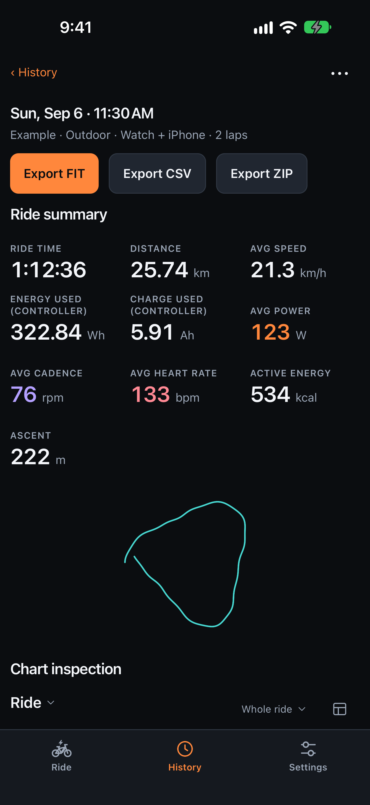
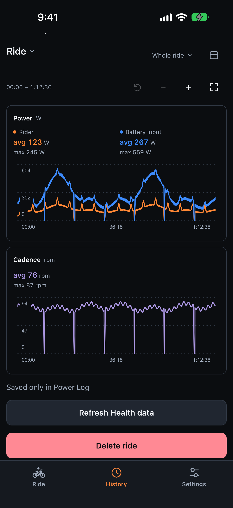
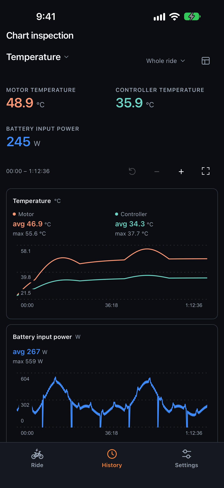
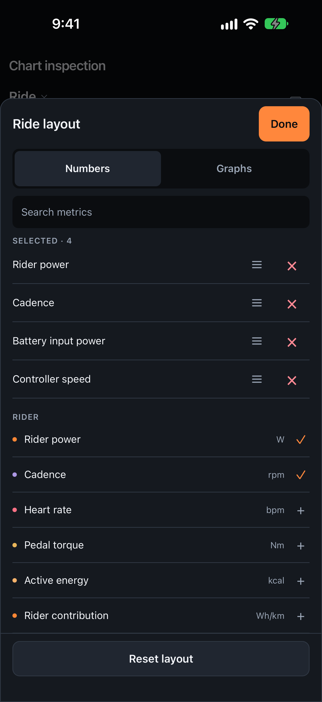
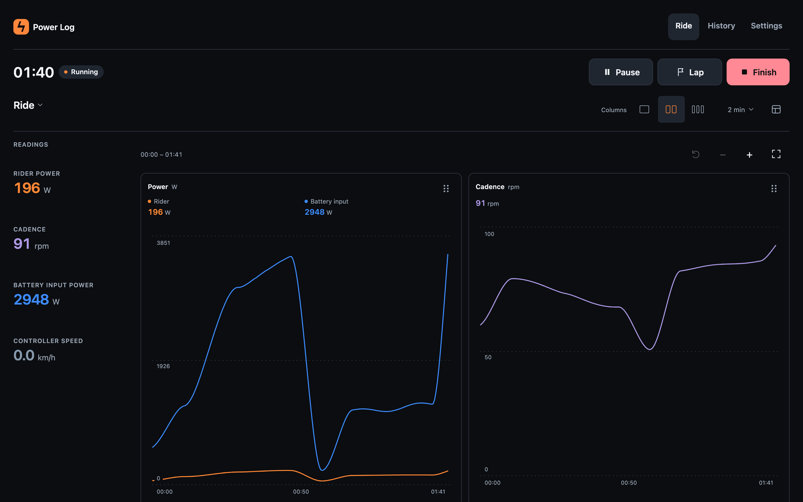

<p align="center">
  
</p>

<h1 align="center">Power Log</h1>

<p align="center">
  Records e-bike rides from CYC X6 and X12 controller telemetry, GPS and Health data,<br>
  on iPhone, Apple Watch, Android and the web.
</p>

<p align="center">
  <a href="https://alekseibespalov.github.io/power-log/"><b>Open the web app</b></a>
  &nbsp;·&nbsp;
  <a href="https://github.com/AlekseiBespalov/power-log/releases/latest/download/power-log.apk"><b>Download for
  Android</b></a>
  &nbsp;·&nbsp;
  <a href="#iphone-and-apple-watch"><b>Build for iPhone</b></a>
</p>

<p align="center">
  <a href="https://github.com/AlekseiBespalov/power-log/releases/latest"></a>
  <a href="LICENSE"></a>
</p>

<p align="center">
  
  
  
  
</p>

<p align="center"><sub>
  Fictional example rides on iPhone. Every screen:
  <a href="artifacts/app-store/screenshots/overview/iphone-overview.png">iPhone</a> ·
  <a href="artifacts/app-store/screenshots/overview/web-overview.png">phone browser</a> ·
  <a href="artifacts/app-store/screenshots/overview/macos-overview.png">computer</a>
</sub></p>

## What it does

- **Live controller data.** Rider power, cadence and pedal torque, battery voltage, current and input power, motor and
  controller temperatures and speed, read from the controller over Bluetooth, with GPS for the route and distance.
- **Charts you arrange.** Each view shows the numbers and graphs you pick. Zoom into any stretch of a ride and read
  exact values at any moment.
- **Files other tools read.** FIT and ride CSV exports for Strava, OVRLEY and other tools, and a ZIP of the original
  data.
- **Health and Apple Watch.** Rides can be saved to Apple Health or Health Connect. The Watch companion adds heart rate
  and ride controls on your wrist.
- **Private and read-only.** Rides stay on your device, and Power Log has no server. It only reads the controller's
  identity and selected telemetry, so it cannot change drive settings or firmware.

## Get Power Log

| Platform | Get it | Records |
| --- | --- | --- |
| **Web** | [Open the web app][web] | Bluetooth and GPS while the page is visible, in a browser with Web Bluetooth such as Chrome; no Health |
| **Android** 9 or later | [Download the APK][apk] | In a foreground service, with optional Health Connect saving; no Watch recording |
| **iPhone**, iOS 26 or later | [Build from source](#iphone-and-apple-watch) | Phone recording, with Apple Health saving and the Live Activity |
| **Apple Watch**, watchOS 10 or later | Built with the iPhone app | A phone-required companion: heart rate, controls and native Health saving |

Every Android release is signed with the same key, so it installs over the previous one; the [release][latest] lists
the APK's checksum in `SHA256SUMS.txt`. iPhone and Apple Watch builds are available from source; the app is not
published on the App Store.

<a href="https://alekseibespalov.github.io/power-log/"></a>
<p align="center"><sub>The web app in a desktop browser, recording a ride.</sub></p>

## Using Power Log

- **Settings** holds the recording defaults: Watch companion, phone GPS, Health saving, distance source and the 2, 4
  or 8 Hz rate. They freeze at Start. Settings also chooses Metric or Imperial units and °C or °F.
- **Apple Watch:** Watch Start waits up to 15 seconds. If it fails, turn off Apple Watch in Settings and start again.
- **Video sync beeps** (Settings, off by default): the phone beeps at Start, Resume and Finish, and the ride starts,
  resumes and ends on the beep. In OVRLEY or Telemetry Overlay, line the start of the FIT or CSV up with the start
  beep in the camera's sound, or the end with the finish beep.
- **After an interruption,** finish the saved portion or discard it. Finishing a ride and exporting it never wait for
  Health.
- **History** shows each ride's status, summary, charts and exports. **Open CSV** reads the `telemetry.csv` of a
  ride-data ZIP.
- **Strava:** export the ride's FIT, save it, choose **Open Strava upload** and select the file on
  [Strava's website](https://www.strava.com/upload/select).

The [privacy policy](https://alekseibespalov.github.io/power-log/privacy) and third-party notices are in Settings →
About and on the website.

## Build from source

| Folder | Holds |
| --- | --- |
| `src/` | The screens, React Native for the phones and the web |
| `modules/power-log/` | The Expo module and the platform adapters |
| `targets/` | The Watch app and the Live Activity |
| `shared/` | The shared Kotlin, with the rules, use cases and storage: one Gradle build of five modules, whose JavaScript builds are checked in under `shared/generated/` |

Expo prebuild regenerates `ios/` and `android/`. Use Node 24 and install the dependencies; `npm run doctor:local`
reports the Node, Xcode, simulator and CocoaPods tools it finds.

```sh
export PATH=/opt/homebrew/opt/node@24/bin:$PATH
npm ci
npm run doctor:local
```

### Web

`npm run web` serves the app locally. `npm run build:pages` builds the website into `dist/` for the `/power-log/` path,
or `npm run build:pages -- /` for a dedicated hostname; serve only `dist/`, over HTTPS, which Web Bluetooth requires.
Prefer a dedicated hostname for real rides: the GitHub Pages project paths of one account share an origin and
therefore browser storage. Every push to `main` deploys the [web app][web] to GitHub Pages.

### iPhone and Apple Watch

Install full Xcode and Bundler, set `DEVELOPER_DIR=/Applications/Xcode.app/Contents/Developer`, and copy
[.env.example](.env.example) to `.env.local` for your signing team and bundle identifier. Then build and install on a
connected iPhone:

```sh
bundle install
npm run prebuild:ios
(cd ios && pod install)
npm run ios
```

A debug build needs `npm start`; use a development build, not Expo Go. `npm run build:ios-simulator` builds for the
simulator. Riding with a bike needs a physical iPhone with Developer Mode.

### Android

Install JDK 17 and the Android SDK with platform tools; set `JAVA_HOME` and `ANDROID_HOME` if they are not detected.

| Command | Does |
| --- | --- |
| `npm run build:android` | Builds a release APK in `artifacts/builds/android/power-log.apk`, signed with the release key from the `POWER_LOG_ANDROID_*` variables below, so it installs over the existing app and keeps its rides. `--arch=arm64-v8a` limits it to one architecture; `--bundle` builds an App Bundle with native symbol tables instead. |
| `npm run android` | Builds and runs a development build, signed with the debug key, on an emulator. |
| `npm run test:android` | Runs the JVM and Robolectric suites. `GRADLE_OPTS=-Dorg.gradle.daemon=false` leaves no Gradle daemon behind. |

<details>
<summary><b>Publishing a release</b></summary>

`npm run release:android -- <version>` builds, signs and publishes a GitHub release from the maintainer's Mac. It
reads the signing key from `POWER_LOG_ANDROID_KEYSTORE`, `POWER_LOG_ANDROID_STORE_PASSWORD`,
`POWER_LOG_ANDROID_KEY_ALIAS` and `POWER_LOG_ANDROID_KEY_PASSWORD`. Keep that key and a backup outside the repository:
every update must be signed with it. With the Google Play upload key in `POWER_LOG_ANDROID_UPLOAD_KEYSTORE`,
`POWER_LOG_ANDROID_UPLOAD_STORE_PASSWORD`, `POWER_LOG_ANDROID_UPLOAD_KEY_ALIAS` and
`POWER_LOG_ANDROID_UPLOAD_KEY_PASSWORD` it also builds the App Bundle for manual upload, and skips it otherwise; only
the APK is published. The bundle, JS source map and native symbols stay in
`~/.cache/power-log/releases/<version>/android/`.

</details>

### Verify

`sh scripts/verify.sh .` is the everyday check of the working directory; `npm run verify` runs the release tier on a
clean copy of `HEAD`. The testing guide covers the [tiers](docs/testing.md#tiers), the
[goldens](docs/testing.md#goldens), [qualification evidence](docs/testing.md#qualification-evidence) and the
[device checks](docs/testing.md#device-checks).

## Project documents

| Document | Covers |
| --- | --- |
| [AGENTS.md](AGENTS.md) | How to change, check and format the code |
| [Architecture](docs/architecture.md) | The layers, slices, modules, storage and bridge |
| [Decisions](docs/decisions.md) | The product and design choices |
| [Testing](docs/testing.md) | Checks, goldens, evidence levels and device procedures |

## License

[Apache-2.0](LICENSE). Free and unsupported, provided as is. No warranty, support or future updates are promised,
subject to applicable law. Measurements may be inaccurate or incomplete; do not rely on the app for safety-critical
decisions.

[web]: https://alekseibespalov.github.io/power-log/
[apk]: https://github.com/AlekseiBespalov/power-log/releases/latest/download/power-log.apk
[latest]: https://github.com/AlekseiBespalov/power-log/releases/latest
